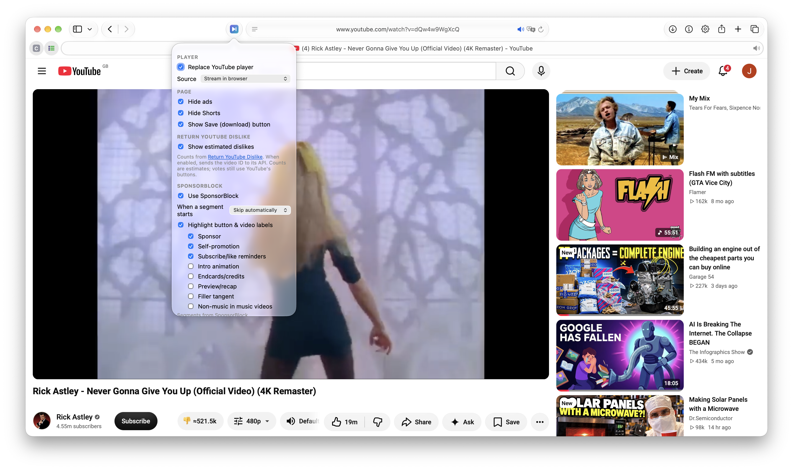

# YT Local Player

> **Not affiliated with, endorsed by, or connected to YouTube or Google.** This is an
> independent, personal-use project. Using it may conflict with YouTube's Terms of Service;
> you are responsible for how you use it. The optional Save button is **off by default**:
> only download videos you have the right to download.



**[Download v2.0.5](https://github.com/mindingulove/yt-local-player/releases/tag/v2.0.5)** for Chrome, Firefox or Safari.
These are **unsigned/manual-install packages**: Chrome requires Developer mode and Load
unpacked; Firefox is not Mozilla-signed and requires Load Temporary Add-on; Safari is
ad-hoc signed, **not Apple Developer-signed or notarized**, and requires Allow unsigned
extensions. For Safari without that option, follow the
**[step-by-step guide to building and signing with your own Apple ID](docs/macos-signing.md)**.

A browser extension for Safari, Chrome and Firefox that swaps YouTube's watch-page player for
its own player. It streams directly from YouTube's video servers, so there are no ads, and it
adds custom controls with thumbnail previews on the seek bar, captions, a quality picker, a mini
player, SponsorBlock, and ad and Shorts hiding. An optional **Save** button (off by default)
downloads the video as an mp4. Nothing needs to run outside the browser.

```
extension/
  lib/innertube.js     session-authenticated web streams, with app-client fallbacks
  lib/dash-player.js   MediaSource player for videos without HLS
  lib/mp4.js           sidx parsing, chunked downloads, video+audio → mp4 muxing (no re-encode)
  lib/controls.js      custom controls: seek bar with SponsorBlock markers + storyboard previews
  content.js           replaces the player, toolbar, SponsorBlock, mini player, ad/Shorts hiding
scripts/               install-safari.sh (signed Safari build) and build-browsers.py (Chrome/Firefox)
vendor/hls.min.js      hls.js for the Chrome/Firefox builds
  popup.*              on/off toggle and source picker
helper/server.py       optional: local yt-dlp server (the "Local yt-dlp helper" source)
YT Local Player/       Xcode wrapper app generated by safari-web-extension-converter
```

## How it plays

1. `innertube.js` first reuses usable streams from the current page, then calls
   `youtube.com/youtubei/v1/player` as the web client with the browser's YouTube cookies
   and session authentication. Cookie values are never exported or stored by the extension.
   The visionOS and iOS app clients remain fallbacks when the web response has no usable
   streams. Web stream signatures (including HLS `n` signatures) are decoded using
   YouTube.js with a bundled interpreter; SABR streams are not supported.
2. If there's an HLS manifest, Safari plays single-language streams natively. Multilingual
   streams use hls.js with the playlist restricted to the selected audio language, keeping
   adaptive quality without switching to another dub.
3. Otherwise `dash-player.js` streams the separate H.264 video and AAC audio tracks through
   MediaSource (up to 1080p).
4. **Save** downloads the best H.264 video and AAC audio tracks in 10 MB chunks. It joins them
   into one mp4 in memory and downloads the result (usually up to 1080p).

## Page features

- **Hide ads:** feed and search ads, promoted videos, banners, the watch-page ad box and
  merch shelves. These are CSS rules keyed on `html.ylp-hide-ads`, so ads that load later are
  hidden too, and whole cards are hidden so grids don't leave gaps.
- **Hide Shorts:** Shorts shelves and cards, the sidebar entry and channel tab. `/shorts/` links
  redirect to the watch page, so they play in this player.
- **SponsorBlock:** segments are looked up by a 4-character SHA-256 prefix of the video ID, and
  the chosen categories are skipped with an Undo notice (or, in "ask" mode, a Skip button).
  Mute segments are silenced, a ★ Highlight button jumps to the highlight, and whole-video
  labels (e.g. "Sponsored video") show in the toolbar. **＋ Segment** submits new segments
  and the skip notice has 👍/👎 votes, using a private random user ID stored locally.
  Segment data is from
  [SponsorBlock](https://sponsor.ajay.app) (CC BY-NC-SA 4.0).
- **Mini player (`i` or ⧉ Mini):** the video floats in a corner and keeps playing while you browse.
  ⤢ returns to the watch page without interrupting playback.
- **Controls:** Safari's native controls are replaced by our own bar, with play/pause, time,
  speed, CC, picture-in-picture and fullscreen. The seek bar shows coloured SponsorBlock
  segments, a highlight tick, and a thumbnail preview on hover (from YouTube's storyboards).
  It auto-hides while playing, and you can click the video to pause or double-click for
  fullscreen.
- **Audio language:** the toolbar lists available audio tracks. Every video starts with
  **Default**, which follows YouTube's default audio track. Pick another language for the
  current video; switching preserves playback position and pause state. Fixed quality and
  Save use the selected audio track too. The next video returns to Default.
- **Quality:** the resolution menu includes both HLS playlist variants and playable MP4
  streams. Fixed HLS resolutions keep the selected audio language and any separate audio
  playlist referenced by the master; Auto adapts quality.
- **Return YouTube Dislike:** a linked **👎 ≈count** chip in the custom player toolbar shows
  estimated dislikes from [Return YouTube Dislike](https://returnyoutubedislike.com/).
  Enabled by default; turn off **Show estimated dislikes** in the popup to stop lookups.
  This sends the current video ID to the RYD API without YouTube cookies or account data.
  Results are cached for ten minutes while the background process is running; rate limits
  trigger backoff. Missing counts display **—**, rather than zero. Counts are estimates,
  and YouTube's own buttons still handle voting; this integration does not submit RYD votes.
  The chip appears with this extension's custom toolbar, not on native live-stream players.
- **Resume:** each video's position is remembered for the tab, and timestamp links in the
  description or comments seek this player.
- **Live streams:** live and scheduled broadcasts automatically keep YouTube's native
  player, including with the local helper selected. Leave the extension enabled; it
  takes over again when you open a regular video. Archived broadcasts play normally.

All of these can be switched on or off in the toolbar popup.

## Setup (Safari, macOS)

To build and sign the extension for your own Mac with your own Apple ID (Apple Account),
follow **[Build and sign for Safari on macOS](docs/macos-signing.md)**. A free Personal Team
works for personal use. The guide covers Xcode installation, Apple ID sign-in, creating an
Apple Development certificate, finding your team ID, compiling, installing, and checking
both signatures. This route does not require Safari's **Allow unsigned extensions** option.

**Which file do I open?** Download the source with **Code → Download ZIP** on GitHub and
extract it. In Finder, open the extracted folder, open **YT Local Player**, then double-click
**YT Local Player.xcodeproj** to open the project in Xcode. Read the linked guide first;
the build/install command is run in Terminal from the extracted folder containing this README.

The Safari ZIP in Releases is **ad-hoc signed**, so that download still needs Safari's
unsigned-extension option. Signing in to Xcode alone does not sign an already-downloaded app;
build from source using the guide. Sharing a normally installable app with other people
requires distribution signing, as explained there.

## Setup (Chrome / Firefox)

Run `python3 scripts/build-browsers.py`. It writes `dist/chrome/`, `dist/firefox/` and a zip of each.
These builds add [hls.js](https://github.com/video-dev/hls.js) for Auto quality, because neither
browser plays HLS natively.

- **Chrome / Edge / Brave:** go to `chrome://extensions`, turn on Developer mode, click
  **Load unpacked** and choose `dist/chrome`.
- **Firefox (128+):** go to `about:debugging#/runtime/this-firefox`, click **Load Temporary
  Add-on** and choose `dist/firefox/manifest.json`. This lasts until Firefox restarts; a
  permanent install needs the zip signed by Mozilla (unlisted signing on addons.mozilla.org).
  Then allow the extension on youtube.com under **Add-ons → YT Local Player → Permissions**:
  Firefox treats MV3 site access as opt-in.

The picture-in-picture button is hidden in Firefox, which doesn't let pages start it.

## Maintenance

- After changing the stream decoder, run `npm ci --ignore-scripts` and
  `npm run build:decipher`, then rebuild Safari or the browser packages. The generated
  `extension/lib/decipher.js` and its licence notices are committed, so normal browser
  builds do not need Node dependencies installed.

- If videos stop loading with "YouTube won't stream this video here", or stop after about a
  minute (403), YouTube has probably changed what it accepts from the app clients. Refresh the
  values in `CLIENTS` in `lib/innertube.js` from YouTube.js's `src/utils/Constants.ts` (or
  yt-dlp's `_INNERTUBE_CLIENTS`).
- Web requests use your existing YouTube login. If YouTube asks you to sign in, click
  **Sign in to YouTube**, complete sign-in in the same browser, and return to the video.
  **Retry** rereads cookies and account configuration. App-client fallbacks remain logged
  out because they do not support web login cookies. Login does not guarantee that YouTube
  will supply a stream format this player supports, or remove every bot challenge.
- Save holds the whole video in memory, which is fine for normal videos but heavy for
  multi-hour 1080p ones.

## Optional: local yt-dlp helper

`brew install yt-dlp ffmpeg`, then run `python3 helper/server.py`, or `helper/install-launchagent.sh`
to run it at login. Then pick **Local yt-dlp helper** in the popup.

## Credits & licences

- Code: [MIT](LICENSE).
- SponsorBlock segment data: [sponsor.ajay.app](https://sponsor.ajay.app), licensed
  [CC BY-NC-SA 4.0](https://creativecommons.org/licenses/by-nc-sa/4.0/).
- Estimated dislike counts: [Return YouTube Dislike](https://returnyoutubedislike.com/),
  via its [public API](https://returnyoutubedislike.com/docs). This integration calls the
  API directly; it does not bundle the Return YouTube Dislike extension's source code.
- [hls.js](https://github.com/video-dev/hls.js): Apache 2.0.
- Control icons: paths from Google's [Material Icons](https://fonts.google.com/icons) (Apache 2.0).
- Client constants (InnerTube visionOS/iOS clients) follow values published by
  [YouTube.js](https://github.com/LuanRT/YouTube.js) and [yt-dlp](https://github.com/yt-dlp/yt-dlp).
- Stream signature decoder: [YouTube.js](https://github.com/LuanRT/YouTube.js) and
  [Sval](https://github.com/Siubaak/sval), MIT. Bundled dependency licences are in
  `extension/lib/decipher.LICENSE.txt`.
